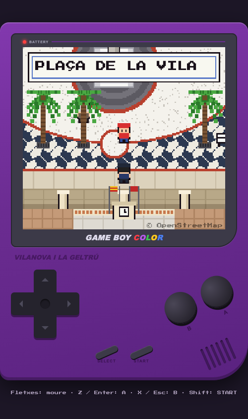

# Pokémon Vilanova

> **Prova.** Experiment en curs, res definitiu.

Joc estil Pokémon Game Boy Color ambientat a la Plaça de la Vila de Vilanova i la Geltrú. El mapa es genera a partir d'OpenStreetMap i s'encaixa a una quadrícula recta.



## Jugar

```sh
python3 -m http.server 8766
```

Obre http://127.0.0.1:8766/. Fletxes per moure, Z/Enter per A, X/Esc per B, Shift per START. Al mòbil hi ha controls tàctils.

## Regenerar el mapa

```sh
python3 tools/osm2map.py           # a partir de tools/osm.json
python3 tools/osm2map.py --fetch   # torna a baixar les dades d'Overpass
python3 tools/osm2map.py --test
```

`map.js` és generat: no l'editis a mà.

Dades del mapa: © OpenStreetMap contributors, ODbL.
